# PRpatch

**An AI-powered CI repair agent that analyzes failed GitHub Actions runs and proposes focused fixes through pull requests.**

PRpatch is an open-source MVP built with FastAPI and Google Agent Development Kit (ADK). When a supported CI workflow fails, the target repository notifies PRpatch. PRpatch retrieves the failed job logs, asks a Gemini-powered agent to identify a likely root cause and suggest a minimal single-file change, validates the proposed change, and—if it passes the guardrails—opens a pull request for a human to review.

> **Status:** MVP / experimental. Automated fixes are suggestions, not guarantees. Review every generated pull request before merging.

## Problem statement

CI failures can take time to diagnose. Developers often need to find the relevant error inside noisy logs, trace it to a source file, make a focused change, and rerun the workflow. This repetitive debugging loop can slow down development, especially when the failure has a clear, localized cause.

## Solution

PRpatch automates part of that loop for GitHub Actions:

1. A failed workflow triggers a notification workflow in the target repository.
2. The notification sends the repository, workflow run ID, commit SHA, and branch to PRpatch.
3. PRpatch authenticates the request and returns `202 Accepted` immediately; repair work runs in a background task.
4. It fetches failed-job logs and trims them to a relevant, model-friendly excerpt.
5. A Google ADK agent examines the log and, when needed, reads relevant repository files at the failing commit.
6. The agent may submit one proposed file replacement. It cannot directly commit or open pull requests.
7. PRpatch validates the change, creates a deterministic `prpatch/` branch, commits the changed file, and opens a pull request.
8. A human reviews the change and decides whether to merge it.

If the agent cannot confidently identify a fix, PRpatch records a diagnosis and stops instead of guessing.

## How it works

```mermaid
flowchart LR
    A[GitHub Actions CI fails] --> B[notify-prpatch workflow_run]
    B -->|POST /webhook with bearer secret| C[FastAPI endpoint]
    C -->|202 Accepted| D[Background repair task]
    D --> E[Fetch failed job logs]
    E --> F[Trim logs and extract error context]
    F --> G[Google ADK agent]
    G --> H[Read repository files at failing commit]
    H --> I[Submit one proposed fix]
    I --> J{Validation passes?}
    J -->|No| K[Log diagnosis and stop]
    J -->|Yes| L[Create branch and commit]
    L --> M[Open pull request]
    M --> N[Human reviews and merges]
```



### Agent tools

The agent is given three guarded tools:

- `list_repository_files` — lists repository file paths at the failing commit.
- `read_file` — reads permitted files at that commit.
- `submit_fix` — submits the complete new content for one previously read file.

The agent does **not** receive tools that directly write to GitHub or create pull requests. The application performs GitHub writes only after validation.

## MVP scope

### Included

- One FastAPI webhook endpoint (`POST /webhook`) and health endpoint (`GET /health`).
- Bearer-secret authentication with constant-time comparison.
- Asynchronous GitHub REST API calls.
- Retrieval of failed GitHub Actions job logs and extraction of relevant error context.
- Google ADK agent using a configurable Gemini model.
- Repository reads pinned to the commit SHA associated with the failed run.
- One-file fixes only.
- Validation for protected paths, Python syntax, JSON syntax, identical output, and a configurable maximum diff size (80 changed lines by default).
- Deterministic branch, commit, and pull-request creation.
- Loop prevention for `prpatch/` branches and in-memory deduplication by repository and commit.
- Retry handling for common transient agent/model errors.
- Automated tests using mocks.

### Deliberately out of scope for this MVP

- GitHub App installation flow.
- Database or persistent job queue.
- Sandbox-based execution of repository code or running the target project's tests before opening a PR.
- Web dashboard or frontend.
- Multi-file fixes.
- Fork pull requests.
- Automatic merging.
- CI providers other than GitHub Actions.

## Technology stack

| Component | Technology |
|---|---|
| API server | Python, FastAPI, Uvicorn |
| Agent framework | Google Agent Development Kit (ADK) |
| Model | Gemini, configurable with `PRPATCH_MODEL` |
| GitHub integration | GitHub REST API via `httpx` |
| Configuration | `python-dotenv` |
| Validation | Python AST parsing, JSON parsing, diff-size guard |
| Tests | `pytest`, `pytest-asyncio`, mocked HTTP transport |
| Notification | GitHub Actions `workflow_run` workflow |

## Project structure

The MVP uses root-level Python modules:

```text
prpatch/
├── main.py                    # FastAPI app, authentication, webhook and health endpoints
├── pipeline.py                # Repair orchestration, retries, branch/commit/PR flow
├── agent.py                   # ADK agent and guarded repository tools
├── github_api.py              # Async GitHub REST API client
├── log_utils.py               # CI log cleanup and error-context extraction
├── requirements.txt
├── pytest.ini
├── .env.example
├── .gitignore
├── tests/
│   ├── conftest.py
│   └── test_all.py
└── examples/
    └── notify-prpatch.yml     # Copy this into the target repository's workflows directory
```

The notification workflow belongs in the **target repository**, not in the PRpatch server repository.

## Prerequisites

- Python 3.10 or newer.
- A GitHub fine-grained personal access token scoped to the target repository or repositories.
- A Google AI Studio API key with Gemini API access.
- A publicly reachable PRpatch server URL for GitHub Actions to call. For local testing, a tunnel such as ngrok can expose the local server.

## Setup

### 1. Clone the repository and create a virtual environment

```bash
git clone https://github.com/YOUR_USERNAME/prpatch.git
cd prpatch

python -m venv .venv
source .venv/bin/activate
```

On Windows, activate the environment with:

```powershell
.venv\Scripts\Activate.ps1
```

### 2. Install dependencies

```bash
python -m pip install --upgrade pip
pip install -r requirements.txt
```

### 3. Configure environment variables

Copy `.env.example` to `.env` and fill in the values:

```dotenv
GOOGLE_API_KEY=
GITHUB_TOKEN=
WEBHOOK_SECRET=
PRPATCH_MODEL=gemini-2.5-flash
PRPATCH_MAX_DIFF_LINES=80
```

| Variable | Purpose |
|---|---|
| `GOOGLE_API_KEY` | API key used by the Gemini-powered ADK agent. |
| `GITHUB_TOKEN` | GitHub token used for repository reads and pull-request creation. |
| `WEBHOOK_SECRET` | Secret required in the `Authorization: Bearer ...` header sent to the webhook. |
| `PRPATCH_MODEL` | Gemini model name; defaults to `gemini-2.5-flash`. Confirm model availability for your API key. |
| `PRPATCH_MAX_DIFF_LINES` | Maximum number of changed lines accepted in the proposed patch; defaults to `80`. |

Generate a strong webhook secret, for example:

```bash
openssl rand -hex 32
```

Use the same secret value for `WEBHOOK_SECRET` on the PRpatch server and the `PRPATCH_WEBHOOK_SECRET` secret in the target repository. Never commit `.env` or hardcode credentials.

### 4. Run the tests

```bash
pytest -q
```

The supplied mocked test suite is expected to report **6 passed**. These tests exercise the local logic with mocks; they do not prove that a live Gemini API key or a live GitHub repository integration is configured correctly.

### 5. Start the server

```bash
uvicorn main:app --host 0.0.0.0 --port 8000
```

Check the health endpoint:

```bash
curl http://localhost:8000/health
```

Expected response:

```json
{"status":"ok"}
```

A webhook request without a valid secret must not be accepted. If `WEBHOOK_SECRET` is missing, the endpoint should return `503`; with a configured secret but missing or incorrect authorization, it should return `401`.

### 6. Expose the local server for a live test

For local experimentation, start a tunnel in another terminal:

```bash
ngrok http 8000
```

Set `PRPATCH_URL` in the target repository to the public HTTPS URL provided by the tunnel, without a trailing slash.

For production, deploy to a long-lived service that can keep background work running. This MVP is not designed for Vercel serverless functions.

## GitHub token permissions

Create a fine-grained personal access token and restrict it to the target repository. The MVP requires:

| Permission | Access |
|---|---|
| Metadata | Read |
| Actions | Read |
| Contents | Read and write |
| Pull requests | Read and write |

The token is used by the server for reading workflow/job information and repository contents, creating a repair branch and commit, and opening a pull request. Store it only in the server's environment; do not put it in the target repository's workflow.

> This MVP uses a fine-grained token, not a GitHub App. A GitHub App is intentionally outside the current scope.

## Configure the target repository

### 1. Add repository secrets

In the target repository, open **Settings → Secrets and variables → Actions** and add:

- `PRPATCH_URL` — the public base URL of the running PRpatch server.
- `PRPATCH_WEBHOOK_SECRET` — the same value configured as `WEBHOOK_SECRET` on the server.

### 2. Add the notification workflow

Copy `examples/notify-prpatch.yml` into the target repository's `.github/workflows/` directory. For example, save it as `.github/workflows/notify-prpatch.yml`.

The example listens for completed workflows named `CI` and notifies PRpatch only when the run failed and belongs to the same repository. Change the `workflows: ["CI"]` value to match the exact `name:` of the workflow you want to monitor.

The notification workflow must be present on the target repository's **default branch** for `workflow_run` events to work as expected.

### 3. Test on a throwaway repository first

Use a disposable repository with a small, reproducible failing test. Push a change that makes CI fail and verify that:

1. The notification workflow runs.
2. The PRpatch server receives the webhook.
3. The server logs the repair result.
4. If a confident fix is found and passes validation, a PR appears from a `prpatch/fix-...` branch.
5. You review the generated diff and confirm the CI behavior yourself.

Do not start by giving the token access to important repositories.

## Security and safety guardrails

PRpatch can create commits and pull requests, so treat it as an experimental automation tool and scope its access carefully.

- **Webhook authentication:** requests require a configured bearer secret; comparisons use constant-time comparison. If the secret is unset, the endpoint fails closed.
- **Untrusted input:** CI logs and repository file contents are treated as untrusted data. The agent instructions tell it not to follow instructions embedded in them.
- **Constrained tools:** the model can list files, read permitted files, and submit one proposed fix. It cannot directly call GitHub write operations.
- **Repository and commit context:** reads are tied to the failing commit SHA; the proposed fix must target a file that was read first.
- **Protected paths:** `.github/` and `.git/` are blocked for agent reads/fixes, and `.env` is protected from reads.
- **Patch checks:** identical content, invalid Python/JSON syntax, and diffs over the configured limit are rejected.
- **Loop prevention:** branches beginning with `prpatch/` are skipped, and the same repository/commit is deduplicated in memory.
- **Human approval:** PRpatch opens a pull request; it does not merge it. Review every patch before merging.
- **Secret handling:** keep credentials out of source control and use a token limited to the required repositories and permissions.

These safeguards reduce risk but do not eliminate it. The MVP does not run the repository's tests in an isolated sandbox before opening a PR.

## Acceptance checklist

Use this checklist to validate the integration in your own environment:

- [ ] Install dependencies and run `pytest -q`; confirm all 6 mocked tests pass.
- [ ] Start the server and verify `GET /health` returns `{"status":"ok"}`.
- [ ] Verify a webhook without valid authorization returns `401` or `503`, never an accepted response.
- [ ] Configure a throwaway repository, the required secrets, and the notification workflow.
- [ ] Trigger a failing CI run and confirm the notification reaches the server.
- [ ] If a fix is accepted, inspect the resulting `prpatch/fix-...` pull request and verify the change and CI results manually.

A successful mocked test suite is not the same as a successful live integration. The live Gemini call and live GitHub repository flow must be verified using your own credentials.

## Known limitations

- **Single-file patches:** only one file is changed per repair attempt.
- **No sandbox validation:** the MVP validates syntax and diff size but does not execute repository tests before opening a PR.
- **Same-repository PRs only:** fork PRs are intentionally unsupported.
- **In-memory deduplication:** processed-commit tracking is lost when the server restarts and is not shared across multiple server instances.
- **Long-lived hosting required:** background repairs may take longer than serverless request limits; do not deploy this MVP to Vercel serverless.
- **Model availability and rate limits:** the configured Gemini model may change availability, and API rate limits can cause retries.
- **No guaranteed fix:** model output can be wrong. If the agent cannot confidently determine a fix, it should stop without opening a PR.
- **Workflow naming:** the notification workflow must listen for the exact CI workflow name and be present on the default branch.

## Roadmap

The roadmap is intentionally limited to validating and hardening the MVP before expanding its scope.

### Phase 1 — Run the MVP end to end
- [ ] Configure Gemini and GitHub credentials.
- [ ] Run the mocked test suite.
- [ ] Complete the live acceptance checklist on a throwaway repository.
- [ ] Document setup and troubleshooting based on actual integration results.

### Phase 2 — Improve reliability and safety
- [ ] Test more real-world CI failure patterns.
- [ ] Review webhook and token handling.
- [ ] Improve error reporting for model, GitHub API, and workflow failures.
- [ ] Assess persistent deduplication and job processing before supporting multiple server instances.

### Phase 3 — Consider future capabilities
Only after the MVP is reliable, evaluate out-of-scope features such as sandboxed test execution, persistent storage/queues, GitHub App authentication, multi-file repairs, and a dashboard. These are **future possibilities, not current MVP features**.

## Troubleshooting

| Symptom | Possible cause | What to check |
|---|---|---|
| `401 Unauthorized` | Server and repository secrets differ | Make `PRPATCH_WEBHOOK_SECRET` exactly match the server's `WEBHOOK_SECRET`. |
| Notification workflow does not run | Workflow name mismatch or workflow file missing from the default branch | Match the `workflows:` entry to the target CI workflow's `name:` and ensure the notifier is on the default branch. |
| GitHub API `403` or `404` | Token permissions or repository selection are insufficient | Confirm the token includes the target repository and the required permissions. |
| API key/model error | Missing key or model unavailable for the account | Check `GOOGLE_API_KEY` and set `PRPATCH_MODEL` to a model currently available to your key. |
| `no_fix` result | The agent could not determine a sufficiently confident fix | Read the server diagnosis and investigate the failure manually. |
| Request accepted but no PR appears | Background repair failed, no failed jobs were found, or hosting stopped the process | Inspect server logs and ensure the service is long-lived and reachable. |

## Contributing

Contributions, bug reports, and focused improvements are welcome. Before proposing a feature, check whether it belongs in the intentionally small MVP or should be discussed as a future extension. Never include API keys, access tokens, private logs, or other secrets in issues or pull requests.

## Team

- Prem Mishra
- Vineet Pandey

## Event

Built for the Hacktoberfest / MLH Hack Day community.

`#HF26Mumbai` · `#OCT27MTP` · `#MUMTECHUP`

## License

Add the project's chosen open-source license before publishing. Until a license is added to the repository, do not assume the code is available for unrestricted reuse.
